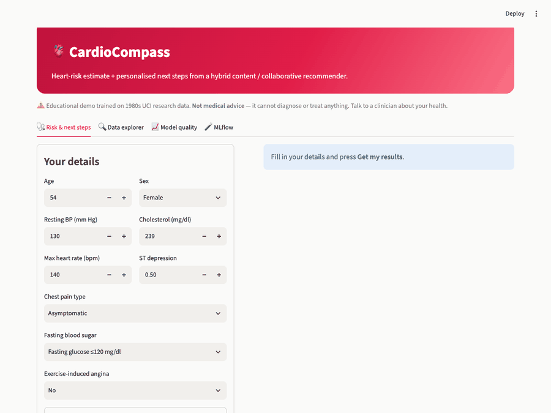

<div align="center">

# 🫀 CardioCompass

**Heart-risk estimate + personalised next steps from a hybrid content / collaborative recommender.**

[**Live demo on Hugging Face Spaces**](https://huggingface.co/spaces/Vaibhavbansal26/cardiocompass) · [Streamlit Cloud](https://medical-app-vb.streamlit.app/)



> ⚠️ Educational demo trained on 1980s UCI research data. **Not medical advice** — it cannot diagnose or treat anything.

</div>

## What it does
1. **Risk model** — predicts a heart-disease risk score from 11 clinical inputs. Candidates (each in one sklearn `Pipeline`, imputation fitted inside CV folds): logistic regression, gradient boosting and a **PyTorch MLP**.
2. **Hybrid recommender** — ranks 13 lifestyle / screening / clinical interventions:
   - **Content-based:** patient *needs* (lipids, BP, glucose, fitness, metabolic, cardiac work-up) matched to each intervention's target vector.
   - **Collaborative:** a PyTorch **two-tower** model. The patient tower is an MLP on features plus the mean embedding of interventions the patient already liked; the item tower is an id embedding plus content features. It handles cold start (features only) and warm start (liked items).
   - **Hybrid:** `α·content + (1-α)·collaborative`, with α tuned on a validation split. A safety rule always surfaces a cardiology referral at high scores.
3. **Education links** from the NIH/NLM [MedlinePlus](https://medlineplus.gov/) web service (free, no key).
4. **MLflow** experiment tracking and model registry, browsable from the app's 🧪 MLflow tab.

## Results
Data: combined UCI Heart Disease (Cleveland + Hungarian + Switzerland + VA Long Beach), **920 patients**. 20% held out for test.

| Risk model | CV AUC | Test AUC | Test Brier ↓ | Leave-one-site-out AUC |
|---|---|---|---|---|
| **Logistic regression** (champion) | 0.879 | 0.912 | 0.115 | 0.815 |
| Gradient boosting | 0.869 | 0.901 | 0.122 | 0.808 |
| PyTorch MLP | 0.867 | 0.918 | 0.113 | 0.787 |

The MLP does not beat logistic regression on 920 rows, so the simpler model is the champion.

| Recommender (NDCG@3, held-out patients) | Popularity | Content | Collaborative | **Hybrid** |
|---|---|---|---|---|
| Cold start (features only) | 0.420 | 0.519 | 0.533 | **0.551** |
| Warm start (one liked item) | 0.395 | 0.493 | 0.504 | **0.527** |

> **Caveat:** no public patient↔intervention feedback dataset exists, so the collaborative model is bootstrapped on a *synthetic* interaction matrix (`recsys.simulate_interactions`). These numbers show the pipeline works; they are not clinical evidence. The app logs 👍/👎 to `data/feedback.csv` so real signal can replace the simulation.

Prevalence varies from 36% to 94% by hospital, which is why we also report leave-one-site-out AUC. See `reports/eda_summary.md` for the full EDA.

## Run it
```bash
pip install -r requirements.txt
python -m medapp.eda          # reports/*.png
python -m medapp.train        # trains, logs to MLflow, registers models, exports artifacts/
streamlit run app.py
mlflow ui --backend-store-uri sqlite:///mlflow.db   # experiments + model registry
pytest tests
```

Docker: `docker compose up --build` → http://localhost:8501

## Project layout
```
app.py              Streamlit app (risk, data explorer, model quality, MLflow tabs)
medapp/data.py      load/clean the 4-site UCI data
medapp/eda.py       EDA plots and statistical tests
medapp/risk.py      logreg / gradient boosting / PyTorch MLP pipelines
medapp/recsys.py    content-based + two-tower collaborative + hybrid recommender
medapp/train.py     CV, leave-one-site-out, MLflow logging + registry, artifact export
medapp/tracking.py  read-only MLflow views for the app
medapp/education.py MedlinePlus lookups
deploy/hf_space.py  publish a Docker Space to Hugging Face
tests/              pytest suite
```

## MLflow
Experiment `heart-risk-recsys`: one parent run for model selection (a child run per model with CV, test and leave-one-site-out metrics) and one run for the recommender. Registered models `heart-risk-classifier` and `intervention-recommender` get the alias `champion`. The deployed app serves the exported copies in `artifacts/` and shows a snapshot of the tracking store.

## Deploy to Hugging Face Spaces
```bash
hf auth login
python deploy/hf_space.py <your-username>/cardiocompass
```
The Space's disk is ephemeral, so 👍/👎 feedback does not persist there.
